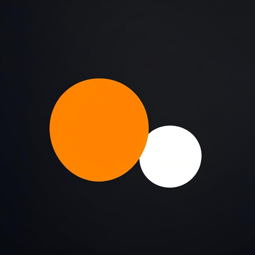

# One Video G

**One Video G** é um editor de vídeo Android mobile-first, offline-first, com exportação real de MP4. Construído com Kotlin, Jetpack Compose e Media3 (ExoPlayer + Transformer). Inspirado nos fluxos úteis de edição populares, com identidade, arquitetura e interface próprias.

**One Video G** is a mobile-first, offline-first Android video editor with real MP4 export. Built with Kotlin, Jetpack Compose and Media3 (ExoPlayer + Transformer).




## Novidades v0.2.0 (pré-visualização = exportação)

- **Pré-visualização em tempo real da composição**: sobreposições (texto/imagem), faixas de áudio, transformações, opacidade, cor e fotogramas-chave são mostrados no editor com a mesma matemática usada na exportação (`docs/PREVIEW_EXPORT_PARITY.md`).
- **Faixas de áudio independentes**: importar, mover, cortar, volume e loop; misturadas na exportação e audíveis na pré-visualização.
- **Fotogramas-chave** para posição X/Y, escala, rotação e opacidade, com interpolação linear/suave e tempos editáveis.
- **Modelo multi-camada**: vídeo, imagem, texto e áudio; manipulação por toque (arrastar/beliscar/rodar) na pré-visualização.
- **Texto**: tipo de letra, negrito/itálico, tamanho, cor e fundo.
- **Exportação em serviço em primeiro plano**: exportações longas já não falham quando o ecrã bloqueia (correção para realme C33 / Android 13); erros mapeados por categoria com registo de diagnóstico; pré-verificação de espaço e limpeza de ficheiros temporários.
- **Duração autoritativa única** para linha temporal, etiquetas, pré-visualização e exportação (`ProjectMath`).

## Funcionalidades implementadas (v0.2.0)

- **Projetos**: criar, abrir, renomear, apagar; autosave JSON atómico; recuperação após interrupções; deteção de ficheiros em falta (reassociar/remover); miniaturas.
- **Importação**: vídeo, áudio (música) e imagens via document picker (SAF) — **sem permissões largas de armazenamento**; thumbnails limitadas e em cache.
- **Timeline**: miniaturas, seleção, corte (trim) com fine-tuning, divisão na posição de reprodução, reordenar (mover ←/→), apagar, zoom, undo/redo (40 níveis), playhead sincronizado.
- **Pré-visualização**: ExoPlayer com recorte por clipe, velocidade de reprodução refletida, play/pause/seek.
- **Ferramentas**: volume por clipe, velocidade (0.5×–2×), formato (16:9, 9:16, 1:1, 4:3, 3:4), ajustes de cor (brilho/contraste/saturação), texto e imagem sobrepostos, faixa de música em loop.
- **Exportação real**: MP4 H.264/AAC via Media3 Transformer; 720p/1080p; qualidade (bitrate); música e efeitos aplicados; progresso real; cancelamento; validação pós-exportação; guardado no local escolhido pelo utilizador (SAF). **100% offline.**
- **Idiomas**: Português e Inglês completos, seletor nas definições, predefinição do sistema, persistido (per-app locales).

## Ferramentas com estado claro

- **Implementado e verificado ao nível de build/testes**: tudo o que está listado acima.
- **Limitações conhecidas (v0.1.0)**: taxa de imagens segue a origem (sem conversão 30/60fps); transições entre clipes ainda não implementadas (planeado); sobreposições e música são aplicadas na exportação (a pré-visualização mostra o vídeo original); uma faixa de vídeo + música (multi-camadas planeado).
- **Importante**: os testes de CI verificam build + testes unitários. O comportamento em execução (encoders, GL, formatos específicos do dispositivo) requer testes em dispositivos físicos — ainda não executados; relatórios de bugs de dispositivo são esperados nesta fase.

## Download — APK assinado

O APK release assinado é publicado automaticamente em cada push para `main`:

1. Abrir o separador **Actions** no GitHub → workflow **Android Release APK**.
2. Artifact `OneVideoG-release-apk` (requer sessão iniciada no GitHub), **ou**
3. **Release "latest"** → `https://github.com/criandojogodenovo-sketch/One-video-G-/releases/tag/latest` (download direto do `.apk`).

Instalação: transferir o `.apk`, tocar nele, autorizar instalação de origem desconhecida se pedido. A assinatura é verificada pelo Android.

## Arquitetura (resumo)

```
app/src/main/java/com/onevideog/editor/
├── data/          # modelos (kotlinx.serialization), repositório de projetos, definições
├── editor/        # TimelineLogic (puro, testável), ViewModel, MediaImporter,
│                  # ExportManager (Media3 Transformer), efeitos (volume/overlay/cor)
└── ui/            # Compose: home, editor (preview+timeline+tools), export, settings
```

- **Media3 1.4.1**: ExoPlayer (pré-visualização), Transformer (exportação), efeitos oficiais (`SpeedChangeEffect`, `Presentation`, `RgbMatrix`, `OverlayEffect`) + `VolumeAudioProcessor` próprio.
- **FFmpeg/NDK**: não usados — sem necessidade até agora (ver `PRODUCT_ANALYSIS.md`).
- **Licenças**: tudo Apache 2.0 (AndroidX/Media3/kotlinx). Sem componentes copyleft no binário.

## Desenvolvimento

```bash
./gradlew assembleRelease        # APK release assinado (requer segredos de assinatura no ambiente)
./gradlew testReleaseUnitTest    # 29 testes unitários
./gradlew lintDebug              # lint
```

CI: `.github/workflows/android-apk.yml` — testes → `assembleRelease` → `apksigner verify` → artifact → release `latest` (só em `main`).

Assinatura: ver `docs/RELEASING.md` (keystore NUNCA commitado; segredos em GitHub Secrets).

## Privacidade

Sem conta, sem rede, sem telemetria. Projetos e vídeos ficam no dispositivo. A exportação escreve apenas no local que o utilizador escolhe.

## Roadmap

1. Testes em dispositivo físico (prioridade máxima antes de divulgar).
2. Transições entre clipes; multi-camadas de vídeo/áudio; editor de timing de sobreposições.
3. Notificação de progresso para exportações longas em segundo plano.
4. Assinatura play-release + preparar candidatura à Play Store.

Consulte `PRODUCT_ANALYSIS.md` para a análise de produto e critérios de aceitação.
